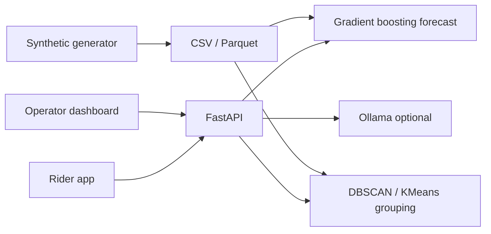

# MetroSync

Last-mile matching for metro riders in Gandhinagar. After tap-in, MetroSync forecasts exits, groups riders heading the same way, and assigns a bay, time slot, and bundled fare before the train arrives.

Light UI only. One calm blue. No dark mode.

## Architecture



- **Data:** peak-shaped ridership for eight Gandhinagar stations, drop clusters, feeder supply.
- **ML:** `GradientBoostingRegressor` for hourly exits; DBSCAN on drop lat/lng + readiness, with KMeans fallback.
- **AI:** Ollama parses free-text drops and writes trip copy. If Ollama is down, rule-based aliases and a template summary are used.
- **Deploy sketch:** API on EC2, static web on S3 or another EC2 service, compose for local/demo.

## Setup

Copy environment values. Never put secrets in source.

```bash
copy .env.example .env
```

### Backend

```bash
cd backend
python -m venv .venv
.venv\Scripts\activate
pip install -r requirements.txt
python scripts/generate_synthetic.py --days 21
pytest
uvicorn app.main:app --reload --host 127.0.0.1 --port 8000
```

Startup also generates data if `data/raw/ridership.csv` is missing.

### Frontend

```bash
cd frontend
npm install
npm run dev
```

Open `http://127.0.0.1:5173`. API default is `http://127.0.0.1:8000`.

### Docker

```bash
copy .env.example .env
docker compose up --build
```

Ollama stays on the host. Set `OLLAMA_BASE_URL=http://host.docker.internal:11434` if you want live parsing.

### AWS (EC2 + S3)

1. Build and push the API image, run it on EC2 with ports 8000 and a persistent `data/` volume.
2. `npm run build` the frontend with `VITE_API_URL` pointing at the EC2 public URL.
3. Sync `frontend/dist` to an S3 bucket (static website or CloudFront).

## REST

| Method | Path | Purpose |
| --- | --- | --- |
| GET | `/health` | Liveness |
| GET | `/stations` | Stations and drop zones |
| GET | `/forecast?station=&horizon=` | Exit demand |
| POST | `/group` | Cluster riders |
| POST | `/rider/trip` | Create assignment |
| GET | `/rider/trip/{id}` | Live pickup card |
| GET | `/dashboard` | Heat, occupancy, wait |
| GET | `/comparison` | Before / after metrics |

## Three-minute demo

1. **0:00** Open the rider app. Confirm tap-in at Infocity. Note the quiet layout: one action, one accent.
2. **0:40** Choose “Infocity offices” or type “TCS Infocity”. Show the pickup card: bay, slot, vehicle, fare. Tap pay.
3. **1:20** Read the trip summary. Mention Ollama if it is running; otherwise the fallback copy.
4. **1:50** Switch to Operate. Heat tiles are demand this hour. Occupancy and wait sit under each station.
5. **2:20** Open Compare. Door-to-door, wait, and occupancy versus the curb-hail baseline.
6. **2:50** Optional: `curl /forecast?station=gift` to show the model behind the tiles.

## Layout

See `backend/` for API, ML, and tests; `frontend/` for the rider and operator UI; `data/` for catalog plus generated CSV/Parquet.
